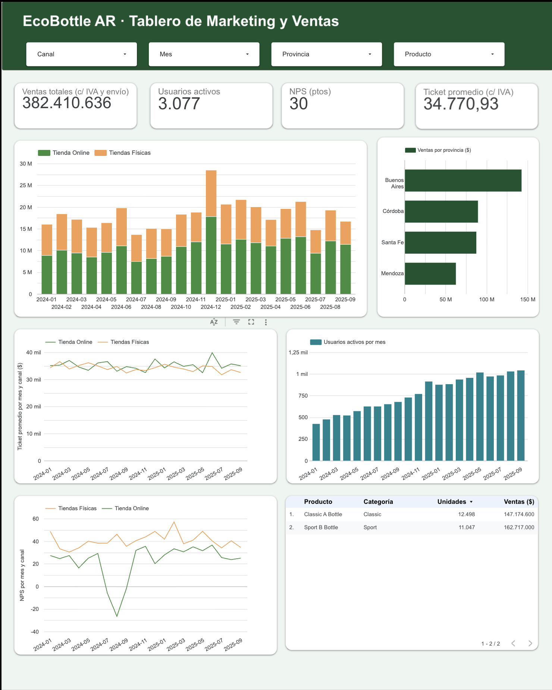

# EcoBottle AR — Data warehouse y KPIs de negocio digital

Práctica de **Introducción al Marketing Online y los Negocios Digitales**.

Este repositorio transforma los datos de origen de EcoBottle AR (13 tablas CSV) en un **data warehouse con modelo estrella** usando **SQL en DuckDB**, y calcula los **KPI** del negocio dentro del propio código SQL. El tablero se alimenta de los CSV resultantes y no recalcula nada.

- **Consigna:** [Práctica](https://docs.google.com/document/d/15RNP3FVqLjO4jzh80AAkK6mUR5DOLqPxLjQxqvdzrYg/edit?usp=sharing)
- **Guía original de la cátedra:** [docs/README_consigna_original.md](docs/README_consigna_original.md)
- **Diagrama del modelo:** [dw/modelo_estrella.md](dw/modelo_estrella.md)

---

## 1. Contenido del repositorio

```
raw/               datos de origen (un CSV por tabla). No se modifican.
sql/
  01_dimensiones.sql   crea las 6 dimensiones
  02_hechos.sql        crea las 6 tablas de hechos
  03_consultas.sql     calcula los KPI (una tabla por KPI)
run_sql.py         ejecuta los SQL en orden y arma el data warehouse
dw/                salida: un CSV por tabla creada + modelo_estrella.md
assets/            diagrama del modelo y captura del tablero
docs/              copia de la guía original de la cátedra
```

## 2. Cómo ejecutarlo

Requisitos: Python 3.9 o superior y Git.

```bash
git clone https://github.com/manumenendez04/practica-imond.git
cd practica-imond
python -m venv .venv
```

Activar el entorno virtual:

- **Mac / Linux:** `source .venv/bin/activate`
- **Windows:** `.venv\Scripts\activate`

Instalar dependencias y generar el warehouse:

```bash
pip install -r requirements.txt
python run_sql.py
```

`run_sql.py` hace cuatro cosas:

1. Crea `warehouse.duckdb` desde cero.
2. Ejecuta los archivos de `sql/` en orden alfabético.
3. Exporta cada tabla creada a un CSV en `dw/` (dimensiones, hechos y KPI).
4. Dibuja el modelo estrella en `dw/modelo_estrella.md`.

Como todo se reconstruye desde cero, correrlo dos veces seguidas produce archivos idénticos (todas las consultas de KPI tienen `ORDER BY`).

## 3. Modelo de datos

Es un modelo en **constelación**: varias tablas de hechos que comparten dimensiones. Cada hecho guarda medidas numéricas y apunta a las dimensiones por clave sustituta (`*_key`).

Diagrama del modelo (se genera con `run_sql.py` y también está en [dw/modelo_estrella.md](dw/modelo_estrella.md)):

```mermaid
erDiagram
    dim_channel ||--o{ fact_nps_response : "channel_key"
    dim_channel ||--o{ fact_payment : "channel_key"
    dim_channel ||--o{ fact_sales_order : "channel_key"
    dim_channel ||--o{ fact_sales_order_item : "channel_key"
    dim_channel ||--o{ fact_shipment : "channel_key"
    dim_customer ||--o{ fact_nps_response : "customer_key"
    dim_customer ||--o{ fact_sales_order : "customer_key"
    dim_customer ||--o{ fact_web_session : "customer_key"
    dim_date ||--o{ fact_nps_response : "date_key"
    dim_date ||--o{ fact_payment : "date_key"
    dim_date ||--o{ fact_sales_order : "date_key"
    dim_date ||--o{ fact_sales_order_item : "date_key"
    dim_date ||--o{ fact_shipment : "date_key"
    dim_date ||--o{ fact_web_session : "date_key"
    dim_location ||--o{ fact_sales_order : "location_key"
    dim_location ||--o{ fact_shipment : "location_key"
    dim_product ||--o{ fact_sales_order_item : "product_key"
    dim_store ||--o{ fact_sales_order : "store_key"
    fact_sales_order ||--o{ fact_payment : "order_id"
    fact_sales_order ||--o{ fact_sales_order_item : "order_id"
    fact_sales_order ||--o{ fact_shipment : "order_id"
    dim_channel {
        INTEGER channel_key PK
        INTEGER channel_id
        VARCHAR code
        VARCHAR name
    }
    dim_customer {
        INTEGER customer_key PK
        INTEGER customer_id
        VARCHAR first_name
        VARCHAR last_name
        VARCHAR status
    }
    dim_date {
        INTEGER date_key PK
        DATE fecha
        INTEGER anio
        INTEGER mes
        VARCHAR anio_mes
        VARCHAR nombre_mes
        INTEGER dia
        VARCHAR dia_semana
    }
    dim_location {
        INTEGER location_key PK
        INTEGER address_id
        VARCHAR city
        VARCHAR province
        VARCHAR province_code
        VARCHAR postal_code
    }
    dim_product {
        INTEGER product_key PK
        INTEGER product_id
        VARCHAR sku
        VARCHAR name
        VARCHAR category
        VARCHAR family
        DECIMAL list_price
    }
    dim_store {
        INTEGER store_key PK
        INTEGER store_id
        VARCHAR name
    }
    fact_nps_response {
        BIGINT nps_id PK
        INTEGER date_key FK
        INTEGER customer_key FK
        INTEGER channel_key FK
        INTEGER score
        VARCHAR nps_category
    }
    fact_payment {
        BIGINT payment_id PK
        BIGINT order_id FK
        INTEGER date_key FK
        INTEGER channel_key FK
        VARCHAR method
        VARCHAR status
        DECIMAL amount
        TIMESTAMP paid_at
        VARCHAR transaction_ref
    }
    fact_sales_order {
        BIGINT order_id PK
        INTEGER date_key FK
        INTEGER customer_key FK
        INTEGER channel_key FK
        INTEGER store_key FK
        INTEGER location_key FK
        VARCHAR status
        DECIMAL subtotal
        DECIMAL tax_amount
        DECIMAL shipping_fee
        DECIMAL total_amount
    }
    fact_sales_order_item {
        BIGINT order_item_id PK
        BIGINT order_id FK
        INTEGER date_key FK
        INTEGER product_key FK
        INTEGER channel_key FK
        VARCHAR status
        INTEGER quantity
        DECIMAL unit_price
        DECIMAL discount_amount
        DECIMAL line_total
    }
    fact_shipment {
        BIGINT shipment_id PK
        BIGINT order_id FK
        INTEGER date_key FK
        INTEGER channel_key FK
        INTEGER location_key FK
        VARCHAR carrier
        VARCHAR tracking_number
        VARCHAR status
        TIMESTAMP shipped_at
        TIMESTAMP delivered_at
        DOUBLE shipping_days
        DOUBLE delivery_days
    }
    fact_web_session {
        BIGINT session_id PK
        INTEGER date_key FK
        INTEGER customer_key FK
        VARCHAR source
        VARCHAR device
        BIGINT duration_seconds
    }
    kpi_entregas_provincia {
        VARCHAR provincia
        BIGINT envios_entregados
        DOUBLE dias_envio_promedio
        DOUBLE dias_entrega_promedio
    }
    kpi_mensual_canal {
        VARCHAR anio_mes
        VARCHAR canal
        BIGINT pedidos
        DECIMAL ventas_sin_iva_ni_envio
        DECIMAL ventas_con_iva_y_envio
        DOUBLE ticket_promedio_sin_iva
        DOUBLE ticket_promedio_con_iva
        BIGINT respuestas
        BIGINT promotores
        BIGINT pasivos
        BIGINT detractores
        DOUBLE nps
    }
    kpi_nps {
        VARCHAR anio_mes
        VARCHAR canal
        BIGINT respuestas
        BIGINT promotores
        BIGINT pasivos
        BIGINT detractores
        DOUBLE nps
    }
    kpi_nps_total {
        BIGINT respuestas
        BIGINT promotores
        BIGINT pasivos
        BIGINT detractores
        DOUBLE nps
    }
    kpi_productos_provincia {
        VARCHAR anio_mes
        VARCHAR canal
        VARCHAR provincia
        VARCHAR producto
        VARCHAR categoria
        HUGEINT unidades
        DECIMAL ventas
    }
    kpi_ranking_productos {
        VARCHAR anio_mes
        VARCHAR canal
        VARCHAR producto
        VARCHAR categoria
        HUGEINT unidades
        DECIMAL ventas
        BIGINT ranking
    }
    kpi_usuarios_activos_diario {
        DATE fecha
        VARCHAR anio_mes
        BIGINT usuarios_activos
        BIGINT sesiones_anonimas
        BIGINT usuarios_activos_con_anonimos
        BIGINT sesiones
    }
    kpi_usuarios_activos_mensual {
        VARCHAR anio_mes
        BIGINT usuarios_activos
        BIGINT sesiones_anonimas
        BIGINT usuarios_activos_con_anonimos
        BIGINT sesiones
    }
    kpi_usuarios_activos_total {
        BIGINT usuarios_activos
        BIGINT sesiones_anonimas
        BIGINT usuarios_activos_con_anonimos
        BIGINT sesiones
    }
    kpi_ventas {
        DATE fecha
        VARCHAR anio_mes
        VARCHAR canal
        VARCHAR provincia
        BIGINT pedidos
        DECIMAL ventas_sin_iva_ni_envio
        DECIMAL ventas_con_iva_y_envio
        DOUBLE ticket_promedio_sin_iva
        DOUBLE ticket_promedio_con_iva
    }
    kpi_ventas_mensual {
        VARCHAR anio_mes
        VARCHAR canal
        BIGINT pedidos
        DECIMAL ventas_sin_iva_ni_envio
        DECIMAL ventas_con_iva_y_envio
        DOUBLE ticket_promedio_sin_iva
        DOUBLE ticket_promedio_con_iva
    }
    kpi_ventas_provincia {
        VARCHAR provincia
        BIGINT pedidos
        DECIMAL ventas_sin_iva_ni_envio
        DECIMAL ventas_con_iva_y_envio
        DOUBLE ticket_promedio_sin_iva
        DOUBLE ticket_promedio_con_iva
    }
    kpi_ventas_total {
        BIGINT pedidos
        DECIMAL ventas_sin_iva_ni_envio
        DECIMAL ventas_con_iva_y_envio
        DOUBLE ticket_promedio_sin_iva
        DOUBLE ticket_promedio_con_iva
    }
```



### Dimensiones

| Dimensión | Una fila por... | Filas |
|---|---|---:|
| `dim_date` | día calendario (2024-01-01 a 2025-09-30) | 639 |
| `dim_channel` | canal de venta (ONLINE / OFFLINE) | 2 |
| `dim_store` | tienda física, más la fila `-1` "Sin tienda (online)" | 5 |
| `dim_location` | dirección (con su provincia), más la fila `-1` "Sin ubicación" | 3.830 |
| `dim_customer` | cliente, más la fila `-1` "Desconocido" | 3.472 |
| `dim_product` | producto (incluye categoría y familia) | 2 |

### Tablas de hechos y su grano

| Hecho | Grano (qué es una fila) | Filas |
|---|---|---:|
| `fact_sales_order` | **un pedido** | 11.969 |
| `fact_sales_order_item` | **una línea de pedido** (un producto dentro de un pedido) | 14.573 |
| `fact_web_session` | **una sesión web** | 100.363 |
| `fact_nps_response` | **una respuesta a la encuesta NPS** | 3.083 |
| `fact_payment` | **un pago** de un pedido | 11.969 |
| `fact_shipment` | **un envío** de un pedido | 7.009 |

Cada hecho conserva **todas** las filas de su tabla de origen: no se filtra ni se pierde nada al cargarlo. Los filtros de negocio (por ejemplo, qué estados cuentan como venta) se aplican al calcular los KPI, no al cargar el hecho.

`fact_sales_order` y `fact_sales_order_item` tienen granos distintos a propósito: el primero responde preguntas por pedido (ventas, ticket promedio, provincia), el segundo por producto (ranking de productos). Por eso `SUM(line_total)` del detalle coincide con `SUM(subtotal)` del pedido.

### Transformaciones principales

- **Claves sustitutas:** cada dimensión genera su `*_key` con `ROW_NUMBER()`; la clave original se conserva como `*_id`.
- **Clave de fecha:** `date_key` es un entero `AAAAMMDD` calculado con `strftime`.
- **Valores desconocidos:** los `LEFT JOIN` con `COALESCE(key, -1)` asignan la fila `-1` cuando no hay dato (pedidos online sin tienda, sesiones y encuestas anónimas). Así ninguna fila se pierde en el cruce.
- **Aplanado de jerarquías:** categoría y familia quedan dentro de `dim_product`; provincia queda dentro de `dim_location`.
- **Tipos:** los montos se castean a `DECIMAL(12,2)` para evitar errores de redondeo de punto flotante.
- **Medidas derivadas:** `duration_seconds` (diferencia entre fin e inicio de la sesión), `shipping_days` (días entre el despacho y la entrega), `delivery_days` (días entre el pedido y la entrega) y `nps_category` (PROMOTER 9–10, PASSIVE 7–8, DETRACTOR 0–6).
- **Integridad:** todas las claves foráneas están declaradas con `REFERENCES`, y DuckDB las valida al cargar.

## 4. Supuestos y decisiones

- **Qué es una venta:** solo los pedidos `PAID` y `FULFILLED`. Se excluyen `CREATED` (no pagado), `CANCELLED` y `REFUNDED`, según la guía de la cátedra.
- **Ventas con y sin IVA:** la consigna define Ventas como `SUM(total_amount)` (incluye IVA y envío). Se calculan **ambas versiones** en columnas separadas (`ventas_con_iva_y_envio` y `ventas_sin_iva_ni_envio`, y lo mismo para el ticket promedio) porque no está definido cuál prefiere el cliente.
- **Usuarios activos:** la consigna indica contar `customer_id` distintos, o `session_id` si son anónimos. Se publican tres columnas: `usuarios_activos` (solo clientes identificados), `sesiones_anonimas` y `usuarios_activos_con_anonimos` (suma de ambas). Esta última es una aproximación: una misma persona anónima con varias sesiones cuenta varias veces.
- **Provincia de las ventas:** se toma de `shipping_address_id`. En compras en tienda esa dirección es la de la tienda.
- **Canal y tienda:** los pedidos online no tienen tienda y se asocian a la fila `-1` de `dim_store` (7.286 pedidos).
- **Moneda y fechas:** montos en pesos argentinos, fechas en hora de Argentina. Los precios de lista no incluyen IVA.
- **Foto de los datos:** corresponden al 30/09/2025 a las 23:59:59.
- **Medidas no aditivas:** NPS, ticket promedio y usuarios distintos no se pueden sumar ni promediar entre períodos. Por eso los KPI guardan también los conteos que los componen (promotores, detractores, pedidos, etc.) y los usuarios activos mensuales se calculan directamente sobre las sesiones del mes, no sumando los diarios.
- **Pagos y envíos:** se modelan como hechos (`fact_payment` y `fact_shipment`). Ambos guardan la fecha del pedido en `date_key` y reutilizan las dimensiones de canal y ubicación (la provincia del envío sale de `shipping_address_id`). Los tiempos de entrega se calculan solo para envíos con estado `DELIVERED` (6.856 de 7.009); el resto no tiene `delivered_at`.

### Controles realizados

- La suma de `total_amount` de los pedidos PAID y FULFILLED en `fact_sales_order` coincide con la de la tabla de origen: **382.410.636,00**.
- `SUM(line_total)` del detalle coincide con `SUM(subtotal)` del pedido: **309.891.600,00**.
- `kpi_ventas` suma esos mismos totales y **10.998 pedidos**.
- No hay pedidos sin cliente ni sin ubicación en `fact_sales_order`.

## 5. KPI

Se calculan en `sql/03_consultas.sql` con `CREATE TABLE ... AS SELECT`, así que cada uno se exporta como CSV a `dw/`. El tablero solo los lee.

| Tabla KPI | Definición | Nivel de detalle | Filas |
|---|---|---|---:|
| `kpi_ventas` | Ventas = `SUM(total_amount)`; Ticket promedio = ventas / cantidad de pedidos (ambos también sin IVA ni envío). Solo PAID y FULFILLED | día, canal y provincia | 4.058 |
| `kpi_usuarios_activos_diario` | Clientes distintos con sesión, sesiones anónimas y su suma | día | 639 |
| `kpi_usuarios_activos_mensual` | Igual, calculado sobre el mes completo | mes | 21 |
| `kpi_nps` | NPS = (% promotores − % detractores) × 100 | mes y canal | 42 |
| `kpi_ranking_productos` | Unidades y ventas (`line_total`) por producto con `RANK()` | mes y canal | 84 |
| `kpi_mensual_canal` | Une `kpi_ventas_mensual` con `kpi_nps`: ventas, ticket promedio y NPS en una sola tabla, para que el tablero no tenga que combinar datos | mes y canal | 42 |
| `kpi_productos_provincia` | Unidades y ventas (`line_total`) por producto, con su categoría. Solo PAID y FULFILLED | mes, canal, provincia y producto | 336 |
| `kpi_ventas_mensual` | Ventas y ticket promedio (con y sin IVA y envío). Solo PAID y FULFILLED | mes y canal | 42 |
| `kpi_ventas_provincia` | Ventas y ticket promedio (con y sin IVA y envío) de todo el período. Solo PAID y FULFILLED | provincia | 4 |
| `kpi_ventas_total` | Ventas y ticket promedio (con y sin IVA y envío) de todo el período. Solo PAID y FULFILLED | total general | 1 |
| `kpi_nps_total` | NPS de todo el período, con los conteos que lo componen | total general | 1 |
| `kpi_usuarios_activos_total` | Clientes distintos con sesión en todo el período, sesiones anónimas y su suma | total general | 1 |
| `kpi_entregas_provincia` | Días promedio de despacho a entrega y de pedido a entrega, solo envíos `DELIVERED` | provincia | 4 |

## 6. Diccionario de datos

### Dimensiones

**dim_date**

| Columna | Descripción |
|---|---|
| `date_key` | Clave (entero `AAAAMMDD`) |
| `fecha` | Fecha |
| `anio`, `mes`, `dia` | Año, mes y día numéricos |
| `anio_mes` | Período `AAAA-MM` |
| `nombre_mes` | Nombre del mes |
| `dia_semana` | Nombre del día de la semana |

**dim_channel:** `channel_key` (clave), `channel_id` (id de origen), `code` (ONLINE / OFFLINE), `name`.

**dim_store:** `store_key` (clave), `store_id` (id de origen), `name`. La fila `-1` representa "Sin tienda (online)".

**dim_location:** `location_key` (clave), `address_id` (id de origen), `city`, `province`, `province_code`, `postal_code`. La fila `-1` representa "Sin ubicación".

**dim_customer:** `customer_key` (clave), `customer_id` (id de origen), `first_name`, `last_name`, `status` (`I` = dio de baja su cuenta). La fila `-1` representa "Desconocido" (anónimo).

**dim_product:** `product_key` (clave), `product_id` (id de origen), `name`, `category`, `family`, `list_price` (precio de lista sin IVA).

### Hechos

**fact_sales_order** (un pedido): `order_id` (PK), `date_key`, `customer_key`, `channel_key`, `store_key`, `location_key` (FK a las dimensiones), `status`, y las medidas `subtotal` (suma de líneas), `tax_amount` (IVA 21 %), `shipping_fee` (envío) y `total_amount` (subtotal + IVA + envío).

**fact_sales_order_item** (una línea de pedido): `order_item_id` (PK), `order_id` (FK al pedido), `date_key`, `product_key`, `channel_key`, `status`, y las medidas `quantity`, `unit_price`, `discount_amount` y `line_total` (cantidad × precio − descuento).

**fact_web_session** (una sesión): `session_id` (PK), `date_key`, `customer_key`, `source` (ads / direct / referral / organic), `device`, `duration_seconds`.

**fact_nps_response** (una respuesta): `nps_id` (PK), `date_key`, `customer_key`, `channel_key`, `score` (0 a 10), `nps_category` (PROMOTER / PASSIVE / DETRACTOR).

**fact_payment** (un pago): `payment_id` (PK), `order_id` (FK al pedido), `date_key` (fecha del pedido), `channel_key`, `method` (CASH / CARD / TRANSFER / GATEWAY), `status` (PENDING / PAID / FAILED / REFUNDED), `amount`, `paid_at` (vacío si no se pagó) y `transaction_ref`.

**fact_shipment** (un envío): `shipment_id` (PK), `order_id` (FK al pedido), `date_key` (fecha del pedido), `channel_key`, `location_key` (provincia de entrega), `carrier`, `tracking_number`, `status` (READY / SHIPPED / DELIVERED / CANCELLED), `shipped_at`, `delivered_at` y las medidas `shipping_days` y `delivery_days`, vacías si el envío no se entregó.

### Tablas de KPI

| Tabla | Columnas |
|---|---|
| `kpi_ventas` | `fecha`, `anio_mes`, `canal`, `provincia`, `pedidos`, `ventas_sin_iva_ni_envio`, `ventas_con_iva_y_envio`, `ticket_promedio_sin_iva`, `ticket_promedio_con_iva` |
| `kpi_usuarios_activos_diario` | `fecha`, `anio_mes`, `usuarios_activos`, `sesiones_anonimas`, `usuarios_activos_con_anonimos`, `sesiones` |
| `kpi_usuarios_activos_mensual` | `anio_mes`, `usuarios_activos`, `sesiones_anonimas`, `usuarios_activos_con_anonimos`, `sesiones` |
| `kpi_nps` | `anio_mes`, `canal`, `respuestas`, `promotores`, `pasivos`, `detractores`, `nps` |
| `kpi_ranking_productos` | `anio_mes`, `canal`, `producto`, `categoria`, `unidades`, `ventas`, `ranking` |
| `kpi_mensual_canal` | `anio_mes`, `canal`, `pedidos`, `ventas_sin_iva_ni_envio`, `ventas_con_iva_y_envio`, `ticket_promedio_sin_iva`, `ticket_promedio_con_iva`, `respuestas`, `promotores`, `pasivos`, `detractores`, `nps` |
| `kpi_productos_provincia` | `anio_mes`, `canal`, `provincia`, `producto`, `categoria`, `unidades`, `ventas` |
| `kpi_ventas_mensual` | `anio_mes`, `canal`, `pedidos`, `ventas_sin_iva_ni_envio`, `ventas_con_iva_y_envio`, `ticket_promedio_sin_iva`, `ticket_promedio_con_iva` |
| `kpi_ventas_provincia` | `provincia`, `pedidos`, `ventas_sin_iva_ni_envio`, `ventas_con_iva_y_envio`, `ticket_promedio_sin_iva`, `ticket_promedio_con_iva` |
| `kpi_ventas_total` | `pedidos`, `ventas_sin_iva_ni_envio`, `ventas_con_iva_y_envio`, `ticket_promedio_sin_iva`, `ticket_promedio_con_iva` |
| `kpi_nps_total` | `respuestas`, `promotores`, `pasivos`, `detractores`, `nps` |
| `kpi_usuarios_activos_total` | `usuarios_activos`, `sesiones_anonimas`, `usuarios_activos_con_anonimos`, `sesiones` |
| `kpi_entregas_provincia` | `provincia`, `envios_entregados`, `dias_envio_promedio`, `dias_entrega_promedio` |

### Tablas de origen (`raw/`)

| Tabla | Qué guarda |
|---|---|
| `channel` | Los 2 canales de venta |
| `province` | Las 4 provincias donde opera la empresa |
| `product_category` | Categorías de producto |
| `product` | Los 2 productos |
| `store` | Las tiendas físicas |
| `customer` | Los clientes |
| `address` | Direcciones de clientes y tiendas |
| `sales_order` | Los pedidos |
| `sales_order_item` | Los productos de cada pedido |
| `payment` | El pago de cada pedido |
| `shipment` | Los envíos por correo |
| `web_session` | Las visitas a la web |
| `nps_response` | Respuestas a la encuesta de satisfacción |

## 7. Tablero

El tablero está hecho en **Looker Studio** y se alimenta de los CSV de `dw/`: no calcula ningún KPI, solo los muestra. Cada gráfico lee una tabla KPI ya calculada en SQL.

Enlace al tablero: https://datastudio.google.com/reporting/23f961c9-28ad-49e0-81b3-94bb45f54caf

Nota: para ver el tablero se requiere una cuenta de Google con la sesión iniciada.

Vistas del tablero (filtros por canal, mes, provincia y producto):

| Vista | Tabla KPI |
|---|---|
| Ventas totales | `kpi_ventas_total` |
| Usuarios activos | `kpi_usuarios_activos_total` |
| NPS | `kpi_nps_total` |
| Ticket promedio | `kpi_ventas` |
| Ventas por mes y canal | `kpi_mensual_canal` |
| Ventas por provincia | `kpi_ventas_provincia` |
| Ticket promedio por mes y canal | `kpi_mensual_canal` |
| Usuarios activos por mes | `kpi_usuarios_activos_mensual` |
| NPS por mes y canal | `kpi_mensual_canal` |
| Ranking de productos | `kpi_productos_provincia` |



## 8. Consultas clave

Cada KPI de la consigna sale de una consulta de `sql/03_consultas.sql`:

| KPI | Tabla | Consulta |
|---|---|---|
| Ventas y Ticket Promedio | `kpi_ventas` | 1 |
| Usuarios Activos | `kpi_usuarios_activos_mensual` | 2 |
| NPS | `kpi_nps` | 3 |
| Ventas por Provincia | `kpi_ventas_provincia` | 4 |
| Ranking mensual por Producto | `kpi_ranking_productos` | 5 |
| Tiempos de entrega por provincia | `kpi_entregas_provincia` | 6 |

**1. Ventas y Ticket Promedio**

```sql
CREATE TABLE kpi_ventas AS
SELECT
    d.fecha,
    d.anio_mes,
    ch.name     AS canal,
    l.province  AS provincia,
    COUNT(*)    AS pedidos,
    SUM(f.subtotal)     AS ventas_sin_iva_ni_envio,
    SUM(f.total_amount) AS ventas_con_iva_y_envio,
    ROUND(SUM(f.subtotal)     / COUNT(*), 2) AS ticket_promedio_sin_iva,
    ROUND(SUM(f.total_amount) / COUNT(*), 2) AS ticket_promedio_con_iva
FROM fact_sales_order AS f
JOIN dim_date     AS d  ON d.date_key     = f.date_key
JOIN dim_channel  AS ch ON ch.channel_key = f.channel_key
JOIN dim_location AS l  ON l.location_key = f.location_key
WHERE f.status IN ('PAID', 'FULFILLED')
GROUP BY d.fecha, d.anio_mes, ch.name, l.province
ORDER BY d.fecha, ch.name, l.province;
```

**2. Usuarios Activos**

```sql
CREATE TABLE kpi_usuarios_activos_mensual AS
SELECT
    d.anio_mes,
    COUNT(DISTINCT CASE WHEN w.customer_key <> -1 THEN w.customer_key END) AS usuarios_activos,
    COUNT(*) FILTER (WHERE w.customer_key = -1)                            AS sesiones_anonimas,
    COUNT(DISTINCT CASE WHEN w.customer_key <> -1 THEN w.customer_key END)
      + COUNT(*) FILTER (WHERE w.customer_key = -1)                        AS usuarios_activos_con_anonimos,
    COUNT(*)                                                               AS sesiones
FROM fact_web_session w
JOIN dim_date d ON d.date_key = w.date_key
GROUP BY d.anio_mes
ORDER BY d.anio_mes;
```

**3. NPS**

```sql
CREATE TABLE kpi_nps AS
SELECT
    d.anio_mes,
    ch.name AS canal,
    COUNT(*) AS respuestas,
    COUNT(*) FILTER (WHERE n.nps_category = 'PROMOTER')  AS promotores,
    COUNT(*) FILTER (WHERE n.nps_category = 'PASSIVE')   AS pasivos,
    COUNT(*) FILTER (WHERE n.nps_category = 'DETRACTOR') AS detractores,
    ROUND(100.0 * (
        COUNT(*) FILTER (WHERE n.nps_category = 'PROMOTER')
      - COUNT(*) FILTER (WHERE n.nps_category = 'DETRACTOR')
    ) / COUNT(*), 1) AS nps
FROM fact_nps_response AS n
JOIN dim_date    AS d  ON d.date_key     = n.date_key
JOIN dim_channel AS ch ON ch.channel_key = n.channel_key
GROUP BY d.anio_mes, ch.name
ORDER BY d.anio_mes, ch.name;
```

**4. Ventas por Provincia**

```sql
CREATE TABLE kpi_ventas_provincia AS
SELECT
    l.province  AS provincia,
    COUNT(*)    AS pedidos,
    SUM(f.subtotal)     AS ventas_sin_iva_ni_envio,
    SUM(f.total_amount) AS ventas_con_iva_y_envio,
    ROUND(SUM(f.subtotal)     / COUNT(*), 2) AS ticket_promedio_sin_iva,
    ROUND(SUM(f.total_amount) / COUNT(*), 2) AS ticket_promedio_con_iva
FROM fact_sales_order AS f
JOIN dim_location AS l ON l.location_key = f.location_key
WHERE f.status IN ('PAID', 'FULFILLED')
GROUP BY l.province
ORDER BY l.province;
```

**5. Ranking mensual por Producto**

```sql
CREATE TABLE kpi_ranking_productos AS
SELECT
    d.anio_mes,
    ch.name     AS canal,
    p.name      AS producto,
    p.category  AS categoria,
    SUM(i.quantity)   AS unidades,
    SUM(i.line_total) AS ventas,
    RANK() OVER (
        PARTITION BY d.anio_mes, ch.name
        ORDER BY SUM(i.line_total) DESC
    ) AS ranking
FROM fact_sales_order_item AS i
JOIN dim_date    AS d  ON d.date_key     = i.date_key
JOIN dim_product AS p  ON p.product_key  = i.product_key
JOIN dim_channel AS ch ON ch.channel_key = i.channel_key
WHERE i.status IN ('PAID', 'FULFILLED')
GROUP BY d.anio_mes, ch.name, p.name, p.category
ORDER BY d.anio_mes, ch.name, ranking, p.name;
```

**6. Tiempos de entrega por provincia**

```sql
CREATE TABLE kpi_entregas_provincia AS
SELECT
    l.province AS provincia,
    COUNT(*)   AS envios_entregados,
    ROUND(AVG(s.shipping_days), 2) AS dias_envio_promedio,
    ROUND(AVG(s.delivery_days), 2) AS dias_entrega_promedio
FROM fact_shipment AS s
JOIN dim_location  AS l ON l.location_key = s.location_key
WHERE s.status = 'DELIVERED'
GROUP BY l.province
ORDER BY l.province;
```

## 9. Hallazgos

Sobre la meta del trimestre (crecer 15 % las ventas en Córdoba y reducir los tiempos de entrega en Mendoza):

- **Córdoba:** en el tercer trimestre de 2025 vendió $12,3 M contra $9,8 M del mismo trimestre de 2024 (**+25,3 %**). Acumulado de enero a septiembre, 2025 está **+14,4 %** sobre 2024, a menos de un punto de la meta.
- **Mendoza:** el tiempo de pedido a entrega bajó de 8,1 días en el tercer trimestre de 2024 a 5,3 días en el tercer trimestre de 2025 (**−35 %**). Aun así, el promedio general (5,7 días) sigue lejos de Buenos Aires (4,0 días); Córdoba (6,0) y Santa Fe (5,8) están en el mismo nivel que Mendoza.
- **NPS:** el NPS total es **30,0**. Tiendas Físicas (40,9) supera a Tienda Online (24,0), y el NPS online llegó a −26,5 en agosto de 2024. Ese mismo trimestre es el de mayor demora de entrega (entre 6,5 y 8,1 días según la provincia), por lo que las demoras logísticas son una causa posible, aunque estos datos no permiten confirmarlo.
- **Canal:** Tienda Online concentra el 59 % de las ventas ($227,0 M de $382,4 M).
- **Productos:** Sport B Bottle vende menos unidades que Classic A Bottle (11.047 contra 12.498) pero factura más ($162,7 M contra $147,2 M), por su precio de lista más alto.

### Ideas para ampliar el tablero

Con los hechos y KPI que ya están en el DW se podrían sumar estas vistas, sin cambiar las dimensiones:

- **Tiempo de entrega por provincia:** barras con `dias_entrega_promedio` de `kpi_entregas_provincia`, para seguir la meta de Mendoza.
- **Meta de Córdoba:** tarjeta con la variación de ventas del trimestre contra el mismo trimestre del año anterior, con el objetivo de +15 %.
- **NPS vs demora de entrega:** comparar la serie mensual de NPS con los días de entrega, para ver si las demoras explican las caídas del canal online.
- **Pagos:** tasa de pagos rechazados por método y canal, a partir de `fact_payment`.
- **Ranking mensual por producto:** barras agrupadas por mes y producto, a partir de una consulta mensual sobre `fact_sales_order_item`.

